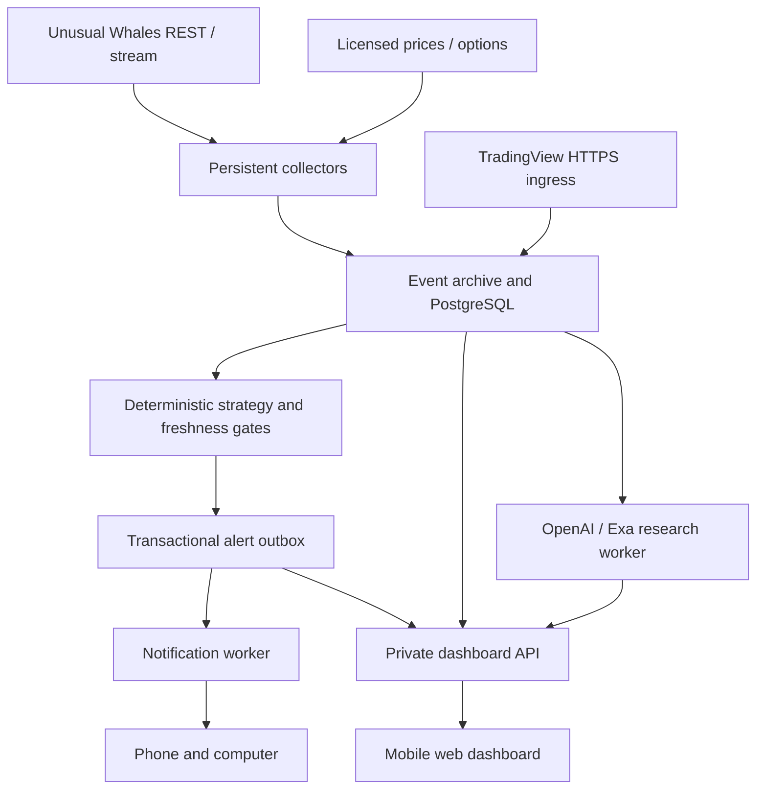

# SPYBOT / Periscope — automated signal platform

Design dated 2026-11-08. Owner: Dakota. Scope: **execution means notifying the owner's phone/computer**, never placing an order. This document records engineering recommendations, not approval of strategy rules or evidence of profitability.

## Decision

Use a Python signal service, a mobile-first web dashboard, persistent collectors, PostgreSQL, a durable notification outbox, and Pushover. Google Cloud is the recommended production base because it fits the existing SPYBOT direction and separates continuous streams from request-driven services. Render web + background worker + PostgreSQL is the simpler alternative. A single VPS is cheaper to reason about initially but transfers patching, backups and recovery to the owner. Do not introduce Kubernetes for this personal workload.

The first implementation is a **local development foundation**: authenticated candidate ingestion, deterministic evidence gates, SQLite outbox, notification worker, and dashboard. It is deliberately blocked until strategy review. It does not yet collect market feeds or evaluate complete SPYBOT strategies automatically. SQLite is not a shared Cloud Run database.

## Production components

| Component | Recommended service | Responsibility |
|---|---|---|
| Dashboard/API | Cloud Run service behind identity-aware HTTPS ingress | Read-only views, authentication, settings and health; separate public webhook ingress if needed |
| Market collector | Cloud Run worker pool, fixed one instance initially | UW and optional Alpaca sockets, heartbeat, bounded reconnect/backoff, gap detection and REST reconciliation |
| Canonical store | Cloud SQL PostgreSQL in same region | Observations, candidate signals, versions, outbox, delivery attempts and audit |
| Raw snapshots | Cloud Storage | Compressed immutable events, retention policy, reproducible point-in-time research |
| Alert worker | Worker pool consuming PostgreSQL outbox initially | Claim due rows atomically, check expiry, send, record provider acceptance |
| Scheduled work | Cloud Scheduler + Cloud Run Jobs | Pre-session calendars, reconciliation, summaries, backtests and cleanup |
| Optional fan-out | Pub/Sub | Add only when collector and consumers need independent replay/fan-out |
| Optional HTTP tasks | Cloud Tasks | Durable HTTP work with bounded retries; not a precise market clock |
| Credentials | Secret Manager + per-service IAM | Distinct data, research, notification and deployment permissions |
| Operations | Cloud Logging / Monitoring, budget alerts | Freshness, disconnects, lag, blocked reasons, failures and backup restore checks |
| Delivery | GitHub Actions + GCP Workload Identity Federation | Tests/build/deploy with short-lived cloud credentials |

Worker pools need at least one running instance for continuous work. Do not rely on an ordinary scale-to-zero HTTP service to keep a collector alive. Cloud Run browser WebSocket requests have a finite timeout (currently up to 60 minutes); reconnect and shared state are required. Initial browser polling is simpler than introducing another streaming protocol.

## Data contracts

Every observation must retain provider, symbol, instrument identity, event time, report time when available, first-seen UTC time, feed entitlement, live/delayed/replay designation, source event ID, completeness and schema version. Preserve the raw payload separately. Current re-downloaded history is not necessarily what the system knew at the time.

Never treat indicative option data as OPRA or IEX-only volume as consolidated volume. Normalize to aware UTC internally; exchange sessions use America/New_York and device displays can use America/Los_Angeles. Use a validated exchange calendar including holidays and early closes; weekday/time checks are insufficient.

Signal records require immutable ID, strategy/version, symbol/direction, observation and expiry times, source IDs, underlying entry/invalidation/target levels, each evidence gate, rejection reasons and delivery state. Underlying levels are not option contract prices. A queued notification is neither an executed trade nor proof of a device display.

## Strategy contract and approval boundary

The current STRATEGY_SIGNOFF.md (v1.0) says REVIEW ONLY. Preserve pending status. Candidate rules: opening-range continuation and Touch & Turn; gamma reversal/premium continuation require their own observations. The original sign-off's proposed 1% per-trade / 3% daily-loss / 3 trades / 2-loss pause are **research simulation proposals**, not approved alert rules. Do not quietly activate them.

Production stages: observe → normalize → classify regime → form setup → confirm → check freshness/conflicts/session/event/liquidity/chop → emit unique signal → invalidate/expire → notify. Exit signals and reversal signals remain separate; a pullback or exit must not flip direction automatically. All required feeds must pass their own age budgets. An LLM cannot override a blocked gate.

The first code slice accepts explicit candidate evidence from a trusted producer. It validates the envelope and booleans; it does not prove those booleans from real source data. Before activation, implement the producer, immutable source snapshots, per-input freshness, exchange-calendar checks and strategy approval binding to a version/hash. The approval environment flag is a local development control, not an owner-signature workflow.

## Alert delivery semantics

1. Commit signal + outbox row atomically with a unique fingerprint. Repeated source delivery must not create another logical signal.
2. Claim due work with a transaction/lease. Re-check strategy status, notification enablement and expiry immediately before send.
3. Use short HTTPS timeouts and bounded exponential backoff with jitter. Obey Retry-After and provider quotas. Do not deliver an expired market setup after recovery.
4. Record pending → processing → provider_accepted / retry / expired / failed. A provider's HTTP success does not establish device delivery.
5. Pushover's normal API has no application-level exactly-once key. A timeout or crash after provider acceptance can cause an uncertain outcome and duplicate push on retry. Do not promise exactly-once phone delivery; include the signal ID in every message.
6. Use a short signal TTL, a clear observation time, the source, the qualifying reason, levels, invalidation and a dashboard deep link. Default to normal priority; emergency loops are unnecessary for this use case.

Example format (template, no current recommendation): `SPY · opening range continuation · SIGNAL_ID. Observed TIME ET. Price/flow/gamma checks confirmed. Underlying level ENTRY; invalidation STOP; reference target TARGET. Valid until EXPIRY. Review evidence: URL.`

## Research and MCP

Use direct REST/WebSocket APIs for repeatable acquisition. MCP is an optional tool interface for Codex/ChatGPT and bounded research, not the scheduler, database or hosting service. Existing ChatGPT connections do not grant a deployed server reusable credentials. No broker server is needed.

OpenAI Responses API may summarize immutable evidence into a validated schema (summary, evidence_ids, uncertainties). Keep model configurable, cap per-request output, maintain daily spend ledger, and cache by snapshot hash. Treat provider/news/repository text as untrusted data. Research failure must not fabricate observations or interrupt deterministic notifications. No OpenAI API key is needed to run this foundation because AI integration is deferred.

Optional owned MCP exposes only `get_system_health`, `list_signals`, `get_signal_evidence`, `get_strategy_version`, `get_backtest_run`. Require OAuth, explicit tool allowlists, data minimization and audit; do not expose arbitrary SQL, shell, secrets or notification-send tools. This owned MCP server is planned, not implemented.

## Delivery milestones

| Stage | Acceptance evidence |
|---|---|
| 1 — foundation (this change) | Dashboard, authenticated API, blocked defaults, candidate gates, local durable outbox, worker and tests |
| 2 — real inputs | UW collector, licensed price feed, calendar, raw archive, gap reconciliation; freshness and entitlement tests |
| 3 — strategy engine | Reproduce exact versioned rules from first-seen data; separate exit/reversal; uncertainty blocks |
| 4 — production storage/identity | PostgreSQL migration + concurrent claims + restart recovery; private dashboard identity; audited ingress |
| 5 — research and evaluation | Optional Responses/Exa, cost ledger, real ETF proxy backtests with holdout and costs; options require bid/ask history |
| 6 — activation | Owner approves strategy version, credentials and entitlements verified, cloud deployed, test notification received, monitor outages |

No six-month backtest or profitable strategy is claimed. Forward evaluation and sign-off remain outstanding. Hosting/provider expenses require the owner's accounts and subscriptions. Budget must be estimated with the selected region, active hours, database sizing, data tiers and retention; no exact production cost is established here.
