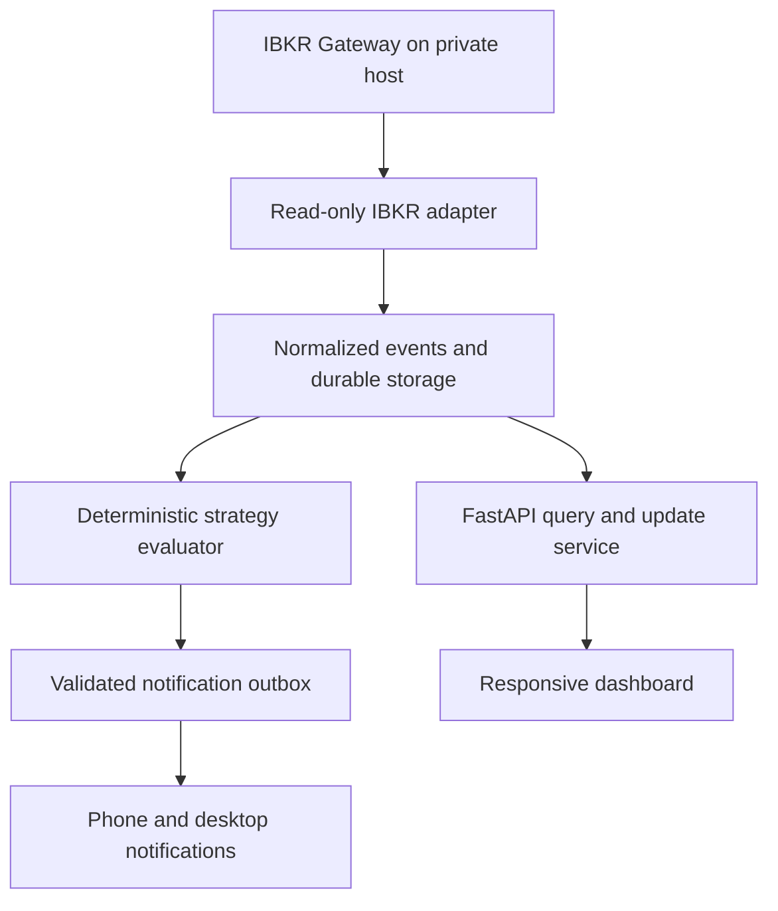

# IBKR integration research and implementation handoff

Research date: November 8, 2026 (America/Los_Angeles).
Repository: bferreal94cc/robinhood-agent-skill.
Status: researched recommendations, not an implemented or certified integration.

## Decision summary

Use IBKR's official hosted MCP for supported interactive AI/account research. Evaluate a separate, persistent, read-only TWS API service through IB Gateway for the custom dashboard's continuous data collection. Prefer the official Python API for vendor support and protocol currency; evaluate `ib_async` behind the same adapter contract if its ergonomics justify its compatibility burden. Do not implement both transports in the first delivery.

Web API remains a viable alternative if the user's actual authentication entitlement supports the intended deployment. Do not assume that retail accounts can use unattended OAuth because an overview advertises OAuth 2.0. Account-specific authentication documentation distinguishes account types. Client Portal Gateway requires daily browser authentication, and IBKR does not support automating that login [S04-S08].

The hosted MCP endpoint is `https://api.ibkr.com/v1/api/mcp-public` [S02]. It is distinct from installing a third-party package named `ibkr-mcp` against a local TWS socket. A chat connection does not establish background-service credentials, streaming capacity, or a deployment runtime.

Scope for the next integration slice: data, account observation where authorized, replay, and research notifications. Order submission is excluded. This preserves the repository's current execution boundary while allowing the newly requested IBKR connection. The older handoff's blanket prohibition on any broker connection needs a focused documentation revision with the integration change; do not silently expand execution authority.

## What was actually inspected

Official IBKR documentation, current authentication guidance, API references and changelogs, plus the maintainers' repository documentation and architecture references for the projects below. Search results and direct page retrieval were both used. Several official `/docs` pages returned HTTP 503 or 403 on direct retrieval; their search-index excerpts and discovered links are marked accordingly in the catalogue. This is a curated implementation index, not a complete offline mirror of every IBKR page. No Reddit sources were used.

The repository's IBKR branch was inspected at commit `52c25190e5b7e22054fda42185285c9df4ee3ea8`: setup scaffolding includes `scripts/install_ibkr.sh` and agent templates. Its Codex JSON template invokes unversioned `uvx ibkr-mcp`, uses port 4001, client ID 0 and LIVE data. The install script swallows the package accessibility probe's failure and subsequently prints success. These are scaffolding observations, not evidence of a working IBKR connection. Re-read branch HEAD before acting; another agent is updating it.

## API routes and fit

| Route | Appropriate use | Automation constraint | Recommendation |
|---|---|---|---|
| Official hosted MCP [S02] | AI-supported account research and supported tools | Authorization and actual tool permissions govern access; no evidence here of a general continuous tick-feed contract | First choice for interactive AI connection |
| TWS API + IB Gateway [S15-S20] | Persistent subscriptions, account observation, historical requests | Stateful process, login/2FA, maintenance and recovery operations | Preferred custom-dashboard candidate, subject to read-only soak test |
| Web API + Client Portal Gateway [S03-S08] | REST/WebSocket workflows for individual accounts | Daily manual browser login; same-machine constraints | Useful prototype/attended alternative; do not promise unattended service |
| Web API + approved OAuth [S04,S09,S10] | Eligible first-party/institutional/approved vendor deployments | Eligibility, registration and key/session flows must be established | Evaluate if IBKR confirms access |
| Flex Web Service [S22-S25] | Periodic activity, statement and reconciliation reports | Asynchronous report production; token, template and report pacing | Complement live data; not a live quote source |
| FIX [S01] | Specialized institutional connectivity | Separate commercial/onboarding and engineering considerations | Catalogue only; unnecessary for current alert platform |
| Excel API [S01] | Spreadsheet workflows | Desktop-oriented operational dependency | Catalogue only |

## Findings that change the design

1. **Authentication is a product requirement.** CPGW has human reauthentication requirements. Its session FAQ describes short inactivity timeouts and regular `/tickle` calls, but a keepalive does not eliminate daily authentication [S05-S07]. Expose `needs_auth` in the UI and notify the operator once per incident.
2. **Official MCP already exists.** IBKR owns its hosted authentication and authorized AI tools [S02]. Its current page also describes a separate autonomous-trading offering; availability and account eligibility must not be inferred for this user. No such feature is requested or enabled by this research.
3. **Data permission differs from connection success.** API market data requires relevant subscriptions/permissions, attached to the username; paper data sharing needs verification [S13,S14]. Show observed data mode, never just requested mode.
4. **Pacing is endpoint-specific.** Web API guidance lists a global 10 requests/second per authenticated username plus narrower endpoint rules [S11]. A September 9, 2026 changelog specifically changes history pacing [S12]. Re-read current rules before setting budgets; do not copy a single hard-coded rate to every endpoint or reuse Web limits for TWS.
5. **Historical coverage is bounded.** TWS documentation excludes bars of 30 seconds or less older than six months, among other restrictions [S19]. For the requested SPY/QQQ six-month OHLC exercise, verify returned minute-bar coverage and gaps; broker history is not assumed to be a complete research archive.
6. **Recovery requires application work.** TWS codes distinguish connection loss, recovery with lost data (1101), and recovery with maintained data (1102) [S20]. Resubscribe selectively, reconcile state, and block signals until freshness is restored.
7. **Maintenance status matters.** `erdewit/ib_insync` is archived (March 14, 2024), and `IbcAlpha/IBC` is archived (September 1, 2026), verified on repository pages and IBC repository metadata [C02,C03]. Familiar tutorials are insufficient evidence of a maintained dependency.

## Designs worth studying

These projects provide inspectable implementations and documentation. None was deployed or benchmarked here; “good reference” is not a profitability or reliability certification.

| Project | Reusable design lesson | Fit and limitations |
|---|---|---|
| `ib-api-reloaded/ib_async` [C01] | Async Python interface, synchronized account state, recipes and watchdog interfaces | Natural fit with current Python backend; unofficial protocol implementation must be version-tested |
| `gnzsnz/ib-gateway-docker` [C04] | Separates Gateway lifecycle into a container; private port bindings, secret-file options, restart configuration | Strong deployment reference, but includes IBC; archive/dependency provenance requires investigation before adoption |
| `IbcAlpha/IBC` [C03] | Login dialogs, scheduled restart, maintenance operations | Archived; reference only pending a maintained dependency decision. Does not bypass mandatory 2FA |
| QuantConnect IB brokerage plugin [C05] | Broker adapter separated from a larger research engine, dedicated test project | Study lifecycle and validation patterns; avoid importing an entire C# engine into this Python platform |
| NautilusTrader IB adapter [C06] | Separate data/execution responsibilities, typed configuration, subscription lifecycle and recovery | Study adapter boundaries and resubscription; current docs have explicit server-protocol compatibility requirements |
| `kelvingao/ibkr-mcp` [C07] | MCP tool organization for portfolio research and market context | Third party, distinct from hosted IBKR MCP; verify package ownership, pinned release, tool inventory and permissions before using |
| `erdewit/ib_insync` [C02] | Historical source of useful async API patterns | Archived; not the default for new dependencies |
| TradingView Lightweight Charts [D01] | Focused financial-chart component instead of rebuilding chart navigation | UI candidate only; no data feed included, and attribution/license conditions need review |

## Proposed architecture

Keep the existing FastAPI and web layers. Do not rewrite the platform to match a reference project.

The Gateway and collector belong on a persistent host with controlled restart and access. A request-only serverless deployment should not own the long-lived desktop Gateway session. The web/API service can use the existing cloud direction after persistent storage, worker hosting and authenticated private connectivity are implemented. Select actual host sizing and cost after measuring the two-symbol collector; no hosting quote is assumed here.

Use one session owner for subscriptions. Coordinate request budgets across collectors and AI consumers. A second agent must not create a competing brokerage session or reuse the collector client ID. Serve most UI reads from normalized storage, not fresh brokerage calls per widget.

Event envelope: provider, resolved contract/conId, symbol, currency, venue, event kind, source timestamp when supplied, observed-at UTC, ingestion timestamp, actual data mode, session ID, payload schema version and provenance. Define identities per event type; do not deduplicate legitimate trades solely because timestamps and prices match. Persist reconnect gaps and contract mappings. Make historical dataset snapshots immutable and checksummed.

Suggested adapter operations: health, resolve contracts, subscribe/unsubscribe quotes and completed bars, bounded historical requests, and explicitly authorized account snapshots. Deliberately omit place/modify/cancel-order methods. Enforce a read-only interface in application code plus Gateway Read-Only API where available. A prompt saying “do not trade” is not the access boundary.

Health states: disconnected, connecting, needs_auth, authenticated, data_unavailable, ready, degraded and recovering. Transport liveness, account access, subscription entitlement and feed freshness are separate checks. Readiness requires a verified handshake plus needed data, not an open port or successful package installation.

## Coordination and delivery sequence

1. **Integration owner:** continue on the existing IBKR work branch, read this research, and choose hosted MCP versus the collector transport explicitly. Do not create another installer branch for the same work. Establish the exact third-party package identity if retaining `ibkr-mcp`.
2. **Configuration repair:** default examples to paper + read-only; reject missing account/host configuration; allocate a documented nonzero client ID; distinguish configured mode from actual account and data mode. Port numbers are configurable, not an account-safety guarantee. Verify current Codex configuration format against official docs rather than copying a generic MCP JSON file.
3. **Installer validation:** fail or report blocked when package resolution/connectivity probes fail. Separate package availability, Gateway availability, authentication, entitlement and live-data checks. Pin reviewed package versions and container digests; avoid curl-to-shell installation as the documented default.
4. **Adapter slice:** implement contract qualification and read-only SPY/QQQ snapshots/bars with bounded requests, explicit state transitions and deterministic replay fixtures. Keep the collector independent from UI requests.
5. **Recovery/storage slice:** persist subscription intent, recover from resets, backfill allowed gaps, deduplicate safely and restore observed data mode. Complete durable PostgreSQL/outbox work already identified in the platform handoff.
6. **UI slice:** follow DASHBOARD_DESIGN_BRIEF.md; consume typed read models and visibly distinguish paper/live/delayed/replay/mock.
7. **Independent reviewer:** inspect the diff and acceptance evidence, including tool inventory and absence of order routes. CI passing is not proof of an authenticated, entitled IBKR feed.

Ownership above describes responsibilities, not assignments to people or agents that have not accepted work. Record actual owner, branch, contract version, dependency and evidence in each PR. Use one canonical integration PR and focused follow-up PRs. Rebase/merge only through normal review; do not overwrite another agent's working branch. The existing hourly review should track the resulting PRs and unresolved dependencies.

## Acceptance evidence required

| Check | Expected evidence |
|---|---|
| Fresh data | Timestamped SPY and QQQ observations during an open session, resolved contracts and actual mode |
| Missing entitlement | Visible blocked state; no silent substitute quotes or signals |
| Authentication expiry/2FA | One operator incident, explicit recovery state, no retry storm |
| Gateway/socket restart | Bounded retry, restored subscriptions, no duplicate logical signals |
| 1101 versus 1102 | Different recovery paths covered by fixtures; no blanket resubscribe storm |
| Gap recovery | Recorded gap and coverage audit; signals resume only when required context is complete |
| Multiple agents | Distinct client IDs or shared session owner; no competing sessions |
| Read-only boundary | No order tool/API route, permission inspection and negative tests without sending a real order |
| UI continuity | Reconnect resumes updates, stale values remain labeled, no whole-page refresh |
| Historical exercise | Six-month SPY/QQQ stock OHLC coverage, explicit cutoff and timezone, checksums and assumptions; no options-return claims |
| Deployment readiness | Soak through a maintenance/restart cycle and a documented reauthentication event; real device delivery evidence |

No connectivity tests, backtests, benchmarks or deployment were performed in this research task. Documentation-only delivery has no applicable application test requirement. Some sources are changing quickly and need rechecking when implementation starts.

## Official documentation catalogue

R = page content retrieved directly; I = verified indexed excerpt, with direct retrieval unavailable or not repeated; H = linked hub for deeper discovery. Review date is the research date above. R does not mean every line or downstream page was audited.

| ID | Document / purpose | Access |
|---|---|---|
| S01 | [API home: Web, TWS, FIX, Excel, reporting and general references](https://www.interactivebrokers.com/docs/) | I/H |
| S02 | [Official AI integrations and hosted MCP](https://www.interactivebrokers.com/en/trading/ai-integrations.php) | R |
| S03 | [Web API overview](https://www.interactivebrokers.com/docs/web-api/introduction) | I |
| S04 | [Authentication methods and supported account types](https://www.interactivebrokers.com/docs/web-api/authentication/introduction) | R |
| S05 | [Authentication FAQ: status, timeout, tickle and reinitialization](https://www.interactivebrokers.com/docs/web-api/authentication/faq) | I |
| S06 | [CP Gateway FAQ: daily login and unsupported automated authentication](https://www.interactivebrokers.com/docs/web-api/authentication/cpgw/client-portal-gateway-faq) | I |
| S07 | [CP Gateway limitations: same-machine requirements](https://ibkrcampus.com/docs/web-api/authentication/cpgw/limitations-of-the-client-portal-gateway) | I |
| S08 | [Getting started: retail versus institutional routes](https://www.interactivebrokers.com/docs/web-api/getting-started) | I |
| S09 | [OAuth 2 access-token construction and prerequisites](https://www.interactivebrokers.com/docs/web-api/authentication/oauth-2/access-token) | I |
| S10 | [OAuth 1 third-party workflow](https://www.interactivebrokers.com/docs/web-api/authentication/oauth-1a/third-party-oauth/third-party-o-auth-workflow) | I |
| S11 | [Web API pacing limits](https://ibkrcampus.com/docs/web-api/trading/usage-and-availability/pacing-limitations) | I |
| S12 | [September 9, 2026 history-pacing change](https://www.interactivebrokers.com/docs/web-api/changelog/2026/9/9) | I |
| S13 | [General API market-data subscriptions](https://www.interactivebrokers.com/docs/general/market-data-subscriptions/introduction) | I |
| S14 | [Third-party FAQ: off-platform and paper username data](https://www.interactivebrokers.com/docs/third-party-integrations/general-third-party-frequently-asked-questions) | I |
| S15 | [TWS API introduction](https://www.interactivebrokers.com/docs/tws-api/doc/introduction) | I |
| S16 | [TWS API settings](https://www.interactivebrokers.com/docs/tws-api/doc/api-settings) | I |
| S17 | [Download TWS/Gateway and autorestart](https://www.interactivebrokers.com/docs/tws-api/doc/download-tws) | I |
| S18 | [TWS pacing](https://www.interactivebrokers.com/docs/tws-api/doc/pacing-limitations) | I |
| S19 | [TWS market data and history limitations](https://www.interactivebrokers.com/docs/tws-api/doc/md/introduction) | I |
| S20 | [TWS message codes: legacy reference, cross-check current installed API](https://interactivebrokers.github.io/tws-api/message_codes.html) | I |
| S21 | [Daily/weekly reauthentication guidance](https://www.interactivebrokers.com/docs/third-party-integrations/tws-settings/daily-weekly-reauthentication) | I |
| S22 | [Flex Web Service hub](https://www.interactivebrokers.com/docs/web-api/flex-web-service/introduction) | H; direct 503 |
| S23 | [Flex token creation](https://www.interactivebrokers.com/docs/web-api/flex-web-service/client-portal-configuration/enable-and-create-access-token) | I |
| S24 | [Flex SendRequest/report generation](https://www.interactivebrokers.com/docs/web-api/flex-web-service/using-flex-web-service/generate-the-report) | I |
| S25 | [Flex GetStatement/report retrieval](https://www.interactivebrokers.com/docs/web-api/api-reference/get-statement) | I |
| S26 | [WebSocket reference introduction](https://www.interactivebrokers.com/docs/web-api/ws/introduction) | I |
| S27 | [Web API endpoint reference entry](https://www.interactivebrokers.com/docs/web-api/api-reference/authentication/oauth-1-0-a/req-temp-token) | R/H |
| S28 | [Web API changelog](https://www.interactivebrokers.com/docs/web-api/changelog) | I/H |
| S29 | [IBKR API education: Python, concurrency, contracts and streaming](https://www.interactivebrokers.com/campus/traders-academy/api/) | I/H |
| S30 | [API discovery index](https://www.interactivebrokers.com/llms.txt) | R/H |
| S31 | [Earlier comprehensive Web API documentation; cross-check current account-specific docs](https://www.interactivebrokers.com/campus/ibkr-api-page/webapi-doc/) | I/H |

### Maintainer-owned implementation references

| ID | Source | Access |
|---|---|---|
| C01 | [ib_async source](https://github.com/ib-api-reloaded/ib_async) and [documentation/recipes/watchdog index](https://ib-api-reloaded.github.io/ib_async/) | R |
| C02 | [Original ib_insync repository, archived](https://github.com/erdewit/ib_insync) | R |
| C03 | [IBC repository and user guide, archived](https://github.com/IbcAlpha/IBC) | R; archive also checked via GitHub API |
| C04 | [IB Gateway Docker source and Compose reference](https://github.com/gnzsnz/ib-gateway-docker) | R |
| C05 | [QuantConnect IB brokerage integration and tests](https://github.com/QuantConnect/Lean.Brokerages.InteractiveBrokers) | R |
| C06 | [NautilusTrader IB integration architecture and recovery](https://nautilustrader.io/docs/latest/integrations/interactive_brokers/) | R |
| C07 | [Third-party ibkr-mcp implementation](https://github.com/kelvingao/ibkr-mcp) and [package listing](https://pypi.org/project/ibkr-mcp/) | I; release/package identity still requires verification |
| D01 | [TradingView Lightweight Charts documentation](https://tradingview.github.io/lightweight-charts/) | R |

The catalogue indexes documents rather than copying vendor manuals. Preserve source licenses and review exact dependency licenses before incorporating code.
